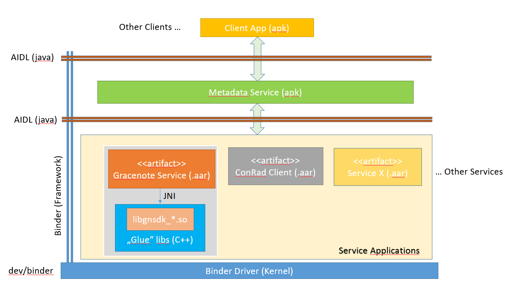

= Entertaintment Metadata Service
:doctype: book
:author: Team Media
:image::cover.jpeg[Logo]

:toc:
:toc-title: Contents
:toclevels: 4

== Revision History

[options="header",cols="*^"]
|====
|Version|Date|Author|Changes

|1
|2020-01-21
|Tugba Mahcup
|Initial version

|====

<<<

== Introduction
=== What is Metadata?
Music metadata is used to identify the embedded data in a music file and includes hundreds of attached text based tags.

In order to enhance the music experience for the embedded automotive systems, metadata support is needed.
Metadata is mostly a collection of different entertainment information such as:

* *albums* (coverart, era, title ..etc)
* *tracks* (era, genre, title ..etc)
* *artists/contributers* (genre, images, name, origin, type ..etc)
* *radio station* (frequency, band, call sign, PI code, signal type, station format, logo ..etc)
* *mood and tempo* (track-level descriptors)
* *images* (radio station logos, artist/genre/coverart images ..etc)
* *audio work* (detailed classical music information from different orchestras, conductors, musicians ..etc)
* *playlists* (set of related media)
* *taste*

=== What is the aim of using a generic Metadata Service?
Metadata providers have some common problems such as:

* No standard database
* Human errors like mispelling (metadata is mostly inserted by humans)
* Changing standards

There are different metadata provider companies and they all have different pros ad cons.
Automotive companies would prefer to use different providers for different reasons (better quality, cheaper licensing ..etc)

The main motivation to have a generic *Entertainment Metadata Service* is to have the capability of using different providers at the backend with the same interfaces. 
Automotive systems have the opportunity to use Gracenote, Spotify, Napster, iTunes, Amazon, Apple ..etc or an in house developed provider at once in that way.

<<<

== General Architecture

<<<

== Component Diagram

[plantuml, component_diagram_1, png]
....

package "MetadataService" {
	[RequestHandler]
	[ServicesManager] 
	[IndexSearcher] 
	database CachingDB <<SQLite>>
	[DatabaseHandler] ..> CachingDB : use
}

package ClientApp

package "ServiceApps" {
	artifact GracenoteService
	artifact ConRadClient
	artifact ServiceX
}

MetadataService -left->ClientApp : AIDL
ClientApp ->MetadataService : AIDL

MetadataService -right->ServiceApps : AIDL
ServiceApps->MetadataService : AIDL

....

OR a central ContentProvider

* ServiceApps will write to DB via ContentProvider
* MetadataService will read from DB via ContentProvider

[plantuml, component_diagram_2, png]
....

package ClientApp
package ContentProvider
database ExternalStorage <<SQLite>>
ContentProvider ..> ExternalStorage : use
 
package "MetadataService" {
	[RequestHandler]
	[ServicesManager] 
	[IndexSearcher] 
	[DatabaseHandler]
}

package "ServiceApps" {
	artifact GracenoteService
	artifact ConRadClient
	artifact ServiceX
}

ClientApp ->MetadataService : AIDL
MetadataService ->ClientApp : AIDL

ContentProvider ->MetadataService : URI
MetadataService ->ContentProvider 

MetadataService -right->ServiceApps : AIDL
ServiceApps->MetadataService : AIDL

ContentProvider -right->ServiceApps : URI
ServiceApps->ContentProvider

....

=== Services Manager

=== Request Handler

=== Database Handler
The reason to have a persistent *Caching Database* mechanism is to achieve high scalability and performance which means high speed. 
In that way, the same query does not need to be processed by every backend service separately if the requested data is already available in the database.

Room Persistance Library within Metadata Service or a generic Content Provider?

=== Index Searcher

<<<

== Activity Diagram - A Simple Use Case
This is a simple use case to describe how a station logo is returned to a Client by Metadata Service.

[plantuml, activity_diagram, png]
....

start
:Start available services;

while (Any request?) is (no)
	:Wait for the requests;
endwhile (yes)
	:Get __Radio Station Logo__;	

if (Already binded to the desired service?) then (no)
	:Bind to the desired service;
else (yes)
endif

:Check __Caching Db__;

if (Hits the __Logo__ in Db?) then (yes)
	:Fetch the Logo from Db;
else (no)
	:Request the Logo from desired service;
	:Save the Logo in Db;
endif

:Return the result to Client;

stop
....

<<<

== Sequence Diagram

[plantuml, audio_setup_diagram, png]
....

participant Client_App as CLIENT
participant Metadata_Service as MANAGER

box "Gracenote_Service"
	participant BACKGROUND as BACKGROUND
	participant Executer_1 as EXE1
	participant Executer_2 as EXE2
	participant Executer_3 as EXE3
	participant Executer_4 as EXE4
end box

participant ConRad_Client as CONRAD
participant Service_X as X

note over MANAGER
<color:red><b>Start available services initially.</b></color> 
They can be created on demand,
but it will definitely take more time!
end note
MANAGER->BACKGROUND:<color:green><b>startService(Gracenote)</b>
MANAGER->CONRAD:<color:blue><b>startService(ConRad)</b>
MANAGER->X:<color:purple><b>startService(X)</b>

CLIENT->MANAGER:<color:green><b>bindService(Gracenote)</b>
MANAGER->BACKGROUND:<color:green><b>bindService(Gracenote)</b>

CLIENT->MANAGER:<color:green><b>requestStationData(Gracenote)</b>
MANAGER->BACKGROUND:<color:green><b>requestStationData(Gracenote)</b>
BACKGROUND->BACKGROUND:<color:green><b>findAvailableExecuter()</b>
activate BACKGROUND#yellow
BACKGROUND->EXE1:<color:green><b>requestStationData(Exe1)</b>
activate EXE1#brown
EXE1->BACKGROUND:<color:green><b>responseStationData()</b>
deactivate EXE1
BACKGROUND->MANAGER:<color:green><b>responseStationData()</b>
deactivate BACKGROUND
MANAGER->CLIENT:<color:green><b>responseStationData()</b>

CLIENT->MANAGER:<color:purple><b>bindService(X)</b>
MANAGER->X:<color:purple><b>bindService(X)</b>

CLIENT->MANAGER:<color:green><b>requestCoverArt(Gracenote)</b>
MANAGER->BACKGROUND:<color:green><b>requestCoverArt(Gracenote)</b>
BACKGROUND->BACKGROUND:<color:green><b>findAvailableExecuter()</b>
activate BACKGROUND#yellow
BACKGROUND->EXE2:<color:green><b>requestCoverArt(Exe2)</b>
activate EXE2#brown
EXE2->BACKGROUND:<color:green><b>responseCoverArt()</b>
deactivate EXE2
BACKGROUND->MANAGER:<color:green><b>responseCoverArt()</b>
deactivate BACKGROUND
MANAGER->CLIENT:<color:green><b>responseCoverArt()</b>

CLIENT->MANAGER:<color:blue><b>bindService(X)</b>
MANAGER->X:<color:blue><b>bindService(X)</b>

CLIENT->MANAGER:<color:blue><b>getRadioStationLogo(ConRad)</b>
MANAGER->CONRAD:<color:blue><b>getRadioStationLogo()</b>
activate CONRAD#orange
note over CONRAD
<color:red><b>Update Radio station logo status and feed Metadata_Service</b></color> 
end note
CONRAD->MANAGER:<color:blue><b>updateRadioStationLogoStatus()</b>
MANAGER->CLIENT:<color:blue><b>updateRadioStationLogoStatus()</b>
note over MANAGER
<color:red><b>Update Radio station logo status and feed Client</b></color> 
end note
CLIENT->MANAGER:<color:blue><b>cancelGetRadioStationLogo(ConRad)</b>
MANAGER->CONRAD:<color:blue><b>cancelGetRadioStationLogo(ConRad)</b>
deactivate CONRAD
CONRAD->MANAGER:<color:blue><b>cancelGetRadioStationLogoResult(ConRad)</b>
MANAGER->CLIENT:<color:blue><b>cancelGetRadioStationLogoResult()</b>

CLIENT->MANAGER:<color:green><b>startRadioSongRecognition(Gracenote)</b>
MANAGER->BACKGROUND:<color:green><b>startRadioSongRecognition(Gracenote)</b>
BACKGROUND->BACKGROUND:<color:green><b>findAvailableExecuter()</b>
activate BACKGROUND#yellow
BACKGROUND->EXE3:<color:green><b>startRadioSongRecognition(Exe3)</b>
activate EXE3#brown
note over EXE3
<color:red><b>Update Radio station song recognition status and feed Metadata_Service</b></color> 
end note
EXE3->BACKGROUND:<color:green><b>updateRadioSongRecognitionStatus()</b>
BACKGROUND->MANAGER:<color:green><b>updateRadioSongRecognitionStatus()</b>
MANAGER->CLIENT:<color:green><b>updateRadioSongRecognitionStatus()</b>
note over MANAGER
<color:red><b>Update Radio station song recognition status and feed Client</b></color> 
end note
CLIENT->MANAGER:<color:green><b>stopRadioSongRecognition(GracNote)</b>
MANAGER->BACKGROUND:<color:green><b>stopRadioSongRecognition(Gracenote)</b>
BACKGROUND->EXE3:<color:green><b>stopRadioSongRecognition(Exe3)</b>
deactivate EXE3
deactivate BACKGROUND

CLIENT->MANAGER:<color:blue><b>startSlideshow(ConRad)</b>
MANAGER->CONRAD:<color:blue><b>startSlideshow()</b>
activate CONRAD#orange
note over CONRAD
<color:red><b>Update Slideshow and feed Metadata_Service</b></color> 
end note
CONRAD->MANAGER:<color:blue><b>updateSlideshow()</b>
MANAGER->CLIENT:<color:blue><b>updateSlideshow()</b>
note over MANAGER
<color:red><b>Update Slideshow and feed Client</b></color> 
end note
CLIENT->MANAGER:<color:blue><b>stopSlideshow(ConRad)</b>
MANAGER->CONRAD:<color:blue><b>stopSlideshow(ConRad)</b>
deactivate CONRAD
CONRAD->MANAGER:<color:blue><b>stopSlideshowResult(ConRad)</b>
MANAGER->CLIENT:<color:blue><b>stopSlideshowResult()</b>

....

<<<

== Interfaces

=== Metadata Service - Client API
==== REQUESTS
Supported requests from Client to Metadata Service are defined as the following:

*_requestRadioStationData(in RadioStationData[] stationList)_*

Response: Yes

	* *RadioStationData* stationList
	
		- *String:* country
		- *String:* band
		- *long:* frequency
		- *String:* name
		- *String/int/ResourceLocater (?):* logoUrl (logoID?)
		- *String/int (?):* stationID
		- *int:* extendedCountryCode
		- *int:* piSid
		- *int:* linkedPiSid
	    - *int:* ensembleId
	    - *int:* scidi
	    - *String:* longName
	    - *String:* shortName
	    - *int:* subChannelId
	    - *String:* stationType
	    - *long:* radioSdsId
        
*_requestCoverArtImage(in CoverArtInfo coverInfo)_*

Response: Yes

	* *CoverArtInfo* coverInfo
	
        - *String:* title
        - *String:* artist
        - *String:* album

*_requestOnlineLookupModeUpdate(in onlineModeOn)_*

Response: Yes

Online lookup mode can be enabled/disabled via this interface.
This interface does not have to be exposed as public. Lookup mode can be configurable and changed internally via this interface.

* *int* onlineModeOn 
	
*_requestRadioStationRDSUpdate(in RadioRDSInfo rdsInfo)_*

Response: No

	* *RadioRDSInfo* rdsInfo 
	
		- *String:* rdsRT
		- *String:* rdsPTY
        - *String:* rdsPI 
		- *CoverArtInfo:* coverInfo (as described above)
		
*_requestRadioSongRecognitionStart(in RadioRDSInfo radioInfo)_*

Response: Yes

	* *RadioRDSInfo* radioInfo (as described above)
	
*_requestRadioSongRecognitionStop()_*

Response: No

*_requestRadioStationLogo(in RadioStationData[] stationList, in logoType)_*

Response: Yes

	* *RadioStationData* stationList (as described above)
	* *int:* logoType

==== RESPONSES        
Supported responses from Metadata Service to Client are defined as the following:

*_responseRadioStationData(in status, in RadioStationData station = null)_*

This interface returns response message to the Client in order to inform about the current status and provide the complete radio station data when it is available. 	

Radio station data is optional - means till it will be provided to the Client; it is null and only status information will be returned.	
	
	* *int* status
	* *RadioStationData* station (as described above)

*_responseCoverArtImage(in ResourceLocater imageLoc)_*

	* *ResourceLocater* imageLoc
	
*_responseOnlineLookupModeUpdate(in status)_*	

This interface returns an API message enum for the lookup mode change request and gives information about the availability of the online lookup mode.
	
	* *int* status
	
*_responseRadioSongRecognitionStart(in status, SongInfo songInfo, ResourceLocator songLoc)_*
	
	* *int* status
	* *ResourceLocator* songLoc
	* *SongInfo* songInfo
		- *CoverArtInfo* coverInfo 
	    - *String:* genre
        - *String:* year
        - *extInfo* list: extInfos
	
*_responseRadioStationLogo(in status, in RadioStationData[] stationList = null)_*

	* *int* status
	* *RadioStationData* stationList (as described above)

*_response

=== Metadata Service - Gracenote Service API

=== Metadata Service - ConRad Client API

